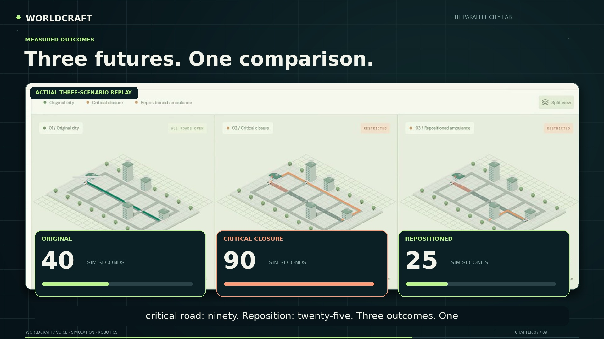
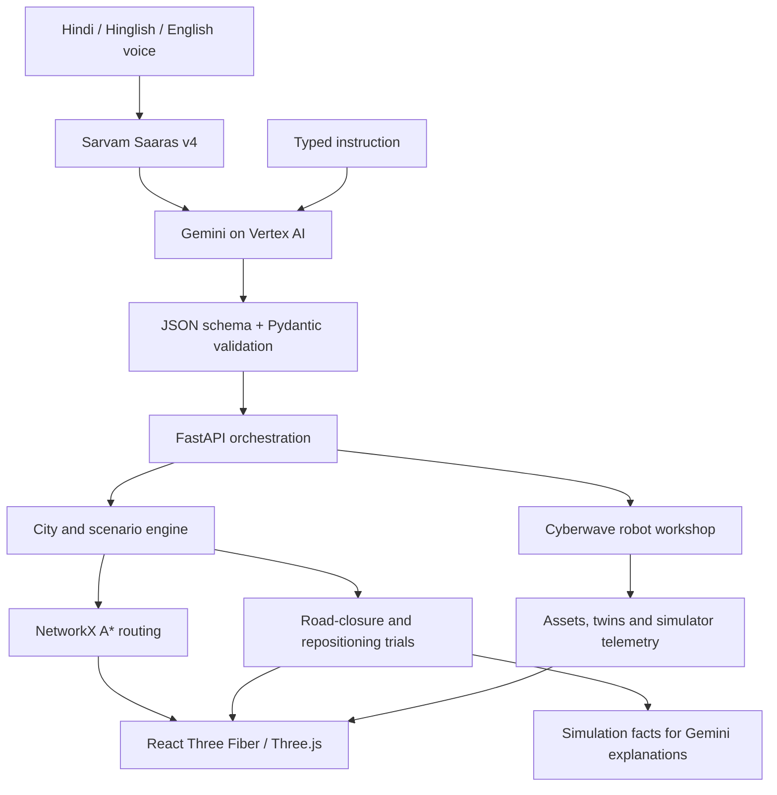

# WORLDCRAFT

### Your words. A world in motion.

**Build a city. Give it a mission. Break the plan. Find a better outcome.**

Voice-controlled city experiments, parallel scenarios and a Cyberwave robotics workshop.

**Hindi · Hinglish · English**

[Watch the demo](docs/assets/worldcraft-demo.mp4) · [Setup guide](docs/SETUP.md) · [Voice commands](#voice-commands)

WORLDCRAFT turns spoken instructions into an interactive 3D simulation workspace. Create a city, dispatch ambulances, change road rules and compare independent futures. Add rescue deadlines, automatically challenge each road in the network, and test how ambulance positioning changes the result. Bring robot assets and digital twins into the same workflow through Cyberwave.

## Voice to world

- **Speak in three languages.** Give instructions in Hindi, Hinglish or English through microphone recording or audio upload.
- **Plan with Gemini on Vertex AI.** Interpret instructions using the current city, roads, buildings, ambulances and scenario context.
- **Execute structured actions.** JSON response schemas and Pydantic validation connect language to application operations.
- **Inspect each command.** View the planned operation, event log and provider indicators from mission control.
- **Explore the local demo.** The explicitly labeled **Local demo · no AI** mode provides deterministic commands for city experiments.

## An interactive 3D city

- Generate cities with named towers, a hospital, roads, trees and ambulance fleets.
- Choose building counts and ambulance counts through instructions.
- Orbit the city, zoom into a route and watch vehicles move through the world.
- Display route lines, road closures, building labels and mission states in 3D.
- Pause, resume, reset and accelerate simulation playback.

## Routing and rescue missions

- Dispatch a selected ambulance between named city locations.
- Calculate routes with **NetworkX A*** over the city's road graph.
- Restrict or reopen the main road, local roads or a specific road segment.
- Recalculate routes as road rules change during a mission.
- Track planned distance, travelled distance, travel time, elapsed time and arrival state.
- Set rescue deadlines and evaluate whether each mission arrives on time.

## Parallel worlds

Branch a scenario into an independent copy, change its rules and run the alternatives together.

- Separate road restrictions, vehicle positions, missions and clocks for each scenario.
- Named branches for comparing different decisions.
- Side-by-side 3D views with independent vehicle movement.
- Repeatable comparison runs from each mission's configured starting point.
- A shared results table for distance, time, deadline and mission outcomes.

## Break My Plan

Turn a dispatched mission into an automated resilience experiment.

1. **Set a deadline.** Define the rescue objective in simulated seconds.
2. **Challenge every road.** Simulate each single-road closure against the selected mission.
3. **Find the critical closure.** Identify the road whose closure breaks the plan and inspect the full trial list.
4. **Test a repair.** Evaluate ambulance starting stations at other city buildings.
5. **Compare three futures.** Replay the original, critical-closure and repositioned scenarios in 3D.
6. **Explain the results.** Gemini selects simulation facts for an explanation rendered from the engine's recorded outcomes.

### A rescue experiment

With a **65-second deadline**, the Tower A experiment compares:

| Scenario | Route distance | Simulated travel time |
| --- | ---: | ---: |
| Original | 480 m | 40 s |
| Critical road closure | 720 m | 90 s |
| Ambulance repositioned before dispatch | 240 m | 25 s |

The same workflow supports changing the city, destination, fleet, deadline and road restrictions before running another experiment.

## Build a robot by voice

> “Mujhe ek robot chahiye jo sirf aage chal sake.”

Use a voice instruction to create a two-wheel robot prototype, register its native model as a Cyberwave asset and instantiate its digital twin in an environment.

- **Describe a prototype.** The forward-moving example includes a chassis, wheel joints, velocity actuators and a Forward/Stop controller.
- **Choose a catalog asset.** Search the Cyberwave catalog and import a robot into the current city workflow.
- **Upload a robot model.** Import self-contained Cyberwave robot-format JSON.
- **Reuse your robot library.** Select an existing robot and attach it to a new city.
- **Inspect the model.** Validate the authored prototype through a Cyberwave schema export and local MuJoCo physics.
- **Request design proposals.** Send custom descriptions to Cyberwave's design-planning interface.

## Cyberwave simulation workflow

### Scene and route linkage

- Map city coordinates into a scaled Cyberwave environment.
- Prepare robot waypoints from a selected ambulance mission.
- Sync city buildings, road markers and closure barriers.
- Stage a robot at its configured starting point.
- Check scene identity and geometry before running a prepared route.

### Robot tests and controls

- Check MuJoCo physics readiness.
- Start a bounded cloud simulation through the workshop controls.
- Refresh simulation status and stop the workshop's simulation run.
- Configure prototype speed and test duration.
- Run prepared navigation goals sequentially with simulator pose feedback.
- Fetch simulator state and show measured robot positions in the 3D city.
- Review measured test history and stop an active robot task.

## Voice commands

| Say or type | Action |
| --- | --- |
| “Ek city banao, chaar towers, ek hospital aur do ambulances.” | Create a city |
| “Hospital se Tower C tak ambulance bhejo.” | Dispatch an ambulance |
| “Main road mat lena.” | Close the main road |
| “Main road phir se khol do.” | Reopen the main road |
| “Is scenario ki parallel copy banao.” | Create an independent branch |
| “Dono scenarios run karke compare karo.” | Replay and compare scenarios |
| “Rescue deadline 65 seconds rakho.” | Set the mission deadline |
| “Har road closure test karo, deadline 65 seconds.” | Run Break My Plan |
| “Simulation ke results explain karo.” | Explain the recorded analysis |
| “Mujhe ek robot chahiye jo sirf aage chal sake.” | Create the robot prototype |
| “Robot ke liye ambulance ka route taiyar karo.” | Prepare robot waypoints |
| “City ko Cyberwave mein sync karo.” | Sync the prepared city scene |
| “Robot se yeh city route chalao.” | Execute the prepared robot route |
| “Robot ki simulator state dikhao.” | Fetch simulator state |
| “Robot roko.” | Stop the robot task |

Commands use the selected scenario and its world context. Name a destination or an ambulance such as `AMB-02` to target a particular mission.

## How it works

## Technology

| Layer | Technology |
| --- | --- |
| Speech recognition | Sarvam Saaras v4 |
| Language planning | Gemini on Google Cloud Vertex AI, Google Gen AI Python SDK |
| API and validation | FastAPI, Pydantic |
| Routing | NetworkX A* |
| Scenario experiments | Custom independent-state simulation engine |
| 3D interface | React, React Three Fiber, Three.js, Drei |
| Robot assets and digital twins | Cyberwave Python SDK, Cyberwave robot format |
| Prototype physics | MuJoCo |
| Frontend tooling | Vite |

---

**[Watch WORLDCRAFT in action](docs/assets/worldcraft-demo.mp4)** · **[Run the project](docs/SETUP.md)**
